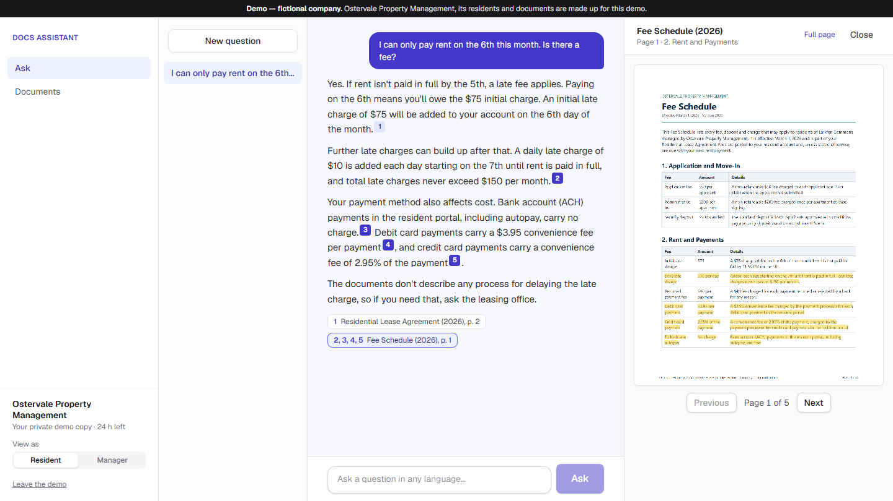
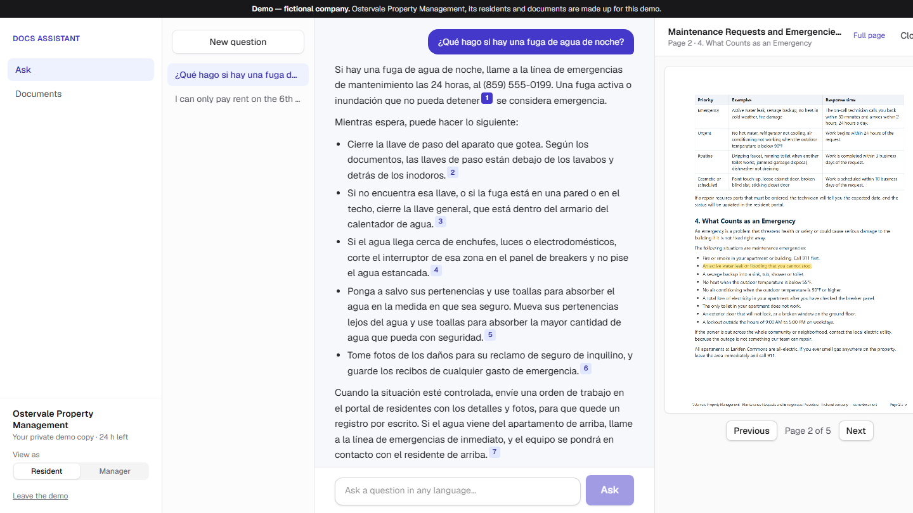
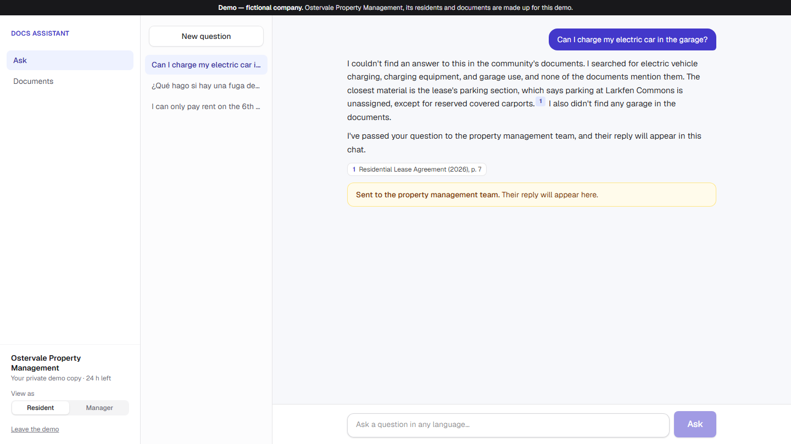
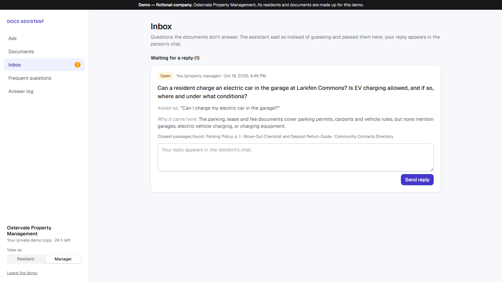
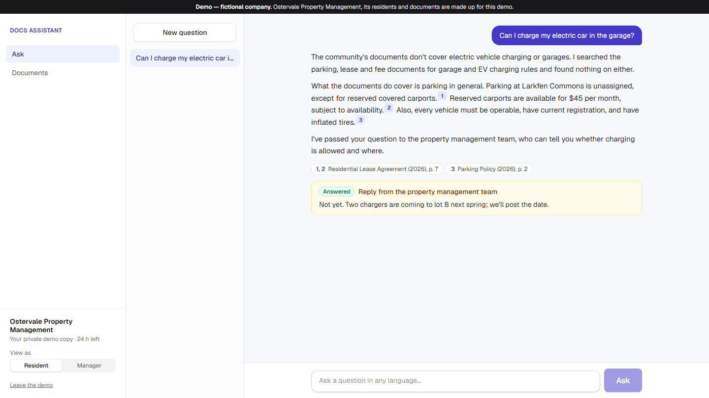
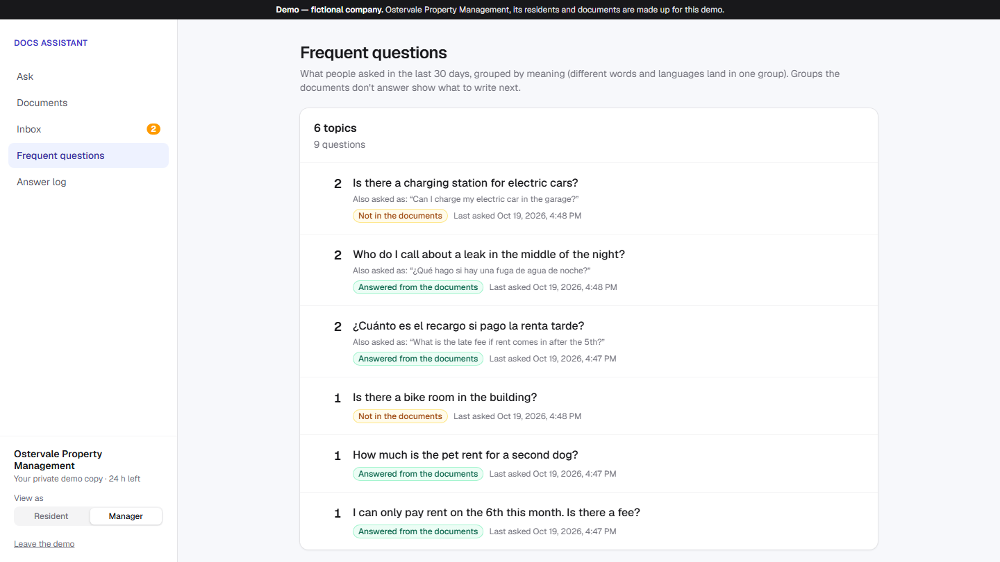
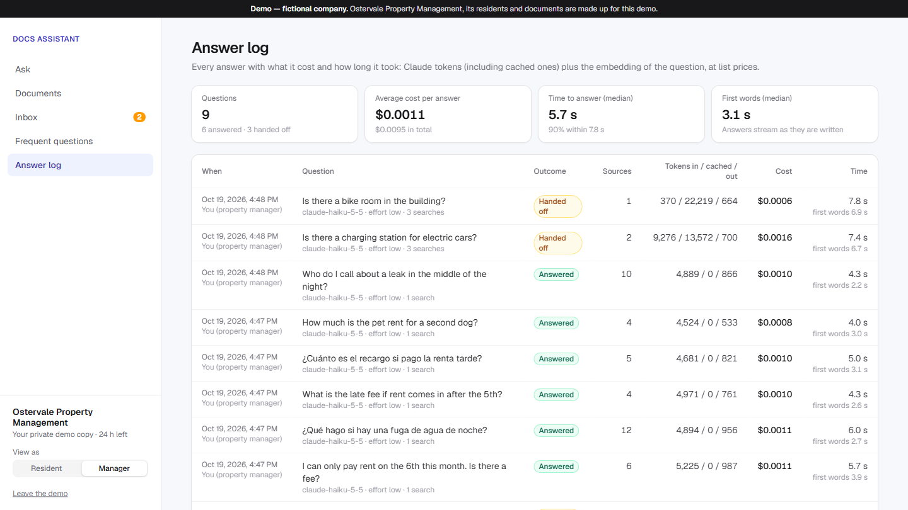
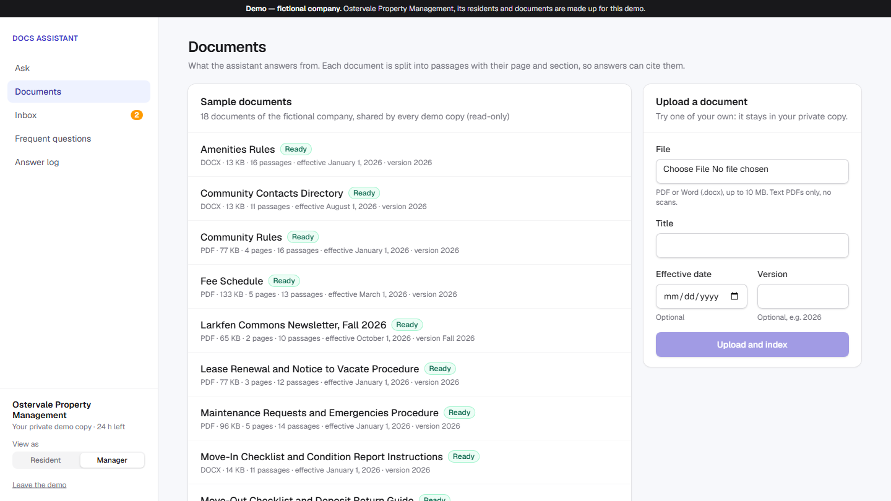
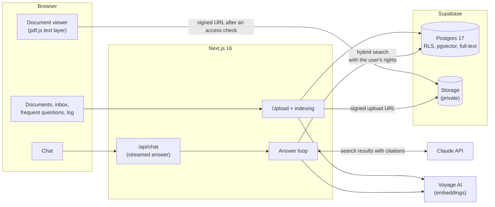

# Docs Assistant

**An assistant that answers from a company's own documents, cites the exact page, and hands off to a human when
the answer isn't there.**
A company uploads its policies, contracts and handbooks as PDF or Word. People ask in plain words, in any
language. The assistant answers only from those documents, and every claim links to the page it came from: one click
opens the document there with the passage highlighted. When the documents don't cover a question, it says so instead
of guessing and passes the question to the team; the reply appears in the same chat.

The demo company is **Ostervale Property Management**, a fictional property manager running Larkfen Commons, an
apartment community in Lexington, KY. Its 18 documents (a lease, house rules, an old and a new pet policy, a fee
schedule, maintenance procedures, move-in and move-out checklists and more; 14 PDF, 4 Word) were written for this
demo. Nothing in the app is specific to property management: each company is a separate tenant with its own documents.

> **Live demo: [docs-assistant-rose.vercel.app](https://docs-assistant-rose.vercel.app).** One click gives you a
> private copy of the demo company for 24 hours, as a resident or as the property manager.

<!-- Demo video goes here. -->

<table>
  <tr>
    <td width="50%">
      
      <br><sub>Every claim is numbered; the cited page opens beside the chat with the lines highlighted</sub>
    </td>
    <td width="50%">
      
      <br><sub>Asked in Spanish, answered in Spanish from English documents, with the same citations</sub>
    </td>
  </tr>
  <tr>
    <td>
      
      <br><sub>Not in the documents: the assistant says so and passes the question to the team</sub>
    </td>
    <td>
      
      <br><sub>The manager's inbox: the question, why it came, what came closest</sub>
    </td>
  </tr>
  <tr>
    <td>
      
      <br><sub>The team's reply appears in the resident's chat, under the question</sub>
    </td>
    <td>
      
      <br><sub>Frequent questions, grouped by meaning across wording and languages</sub>
    </td>
  </tr>
  <tr>
    <td>
      
      <br><sub>Answer log: tokens, cost and time of every answer</sub>
    </td>
    <td>
      
      <br><sub>Documents with versions and effective dates; uploads stay in the visitor's private copy</sub>
    </td>
  </tr>
</table>

## What a company gets

- **Answers people can check.** Each answer cites the document and page; the source opens beside the chat with the
  cited lines highlighted. Questions in Spanish or Russian get answers in Spanish or Russian from English documents.
- **No made-up answers.** If the documents don't say it, the assistant says so plainly and hands the question to the
  team, with what it searched and what came closest. The reply goes back to the person who asked.
- **The current rule, not an old one.** Documents carry an effective date and can replace an older version; when
  versions disagree, the answer follows the one in effect and mentions that the rule changed.
- **A list of what to write next.** Questions are grouped by meaning, across wording and languages, so the team
  sees which topics come up and which ones the documents don't cover.
- **Known cost per answer.** Every answer is logged with its tokens, price and response time; the eval below
  measures accuracy and cost on three models, so the model is a business decision, not a guess.

## Guarantees, enforced and tested

| Guarantee                                                   | How                                                                                                                        | Checked by                                                                |
| ----------------------------------------------------------- | -------------------------------------------------------------------------------------------------------------------------- | ------------------------------------------------------------------------- |
| Company A never sees company B's documents, search included | Row-level security on every table, read-only grants; the search function runs with the signed-in user's rights             | 44 pgTAP checks, including a search called with another company's ids     |
| A demo visitor's uploads stay private                       | Each visitor gets a sandbox company that reads the sample documents read-only and keeps its own uploads, questions and log | pgTAP                                                                     |
| Answers come only from the documents                        | Passages reach Claude as search results with citations on; the prompt forbids filling gaps from general knowledge          | 50-question eval (below)                                                  |
| Every claim links to its page                               | Citations name the exact paragraphs; each passage carries its document, page and section                                   | Eval: right page cited                                                    |
| A question the documents don't answer reaches a person      | A hand-off tool creates the inbox item; the chat shows "sent to the team" only from the server's record                    | Eval: 10 questions not in the documents; end-to-end test of the full loop |
| Documents can't give the assistant orders                   | Document text is passed only as search results, never as instructions                                                      | Eval: 2 prompt injections planted in a document                           |
| Keys and files stay on the server                           | Server-only modules; files are read through short-lived signed URLs after an access check                                  | Code review, pgTAP (no direct bucket access)                              |

## The problem

Companies already have the answers, in documents nobody reads: a 12-page lease, a pet policy that changed in March,
a fee table. Residents and employees ask the office instead, the office answers the same questions every day, and a
chatbot on top of the documents is only useful if people can trust it: it must show where an answer comes from,
follow the current version, and admit when the documents are silent.

## How it works



**Indexing.** A PDF's text layer has positioned runs of text, not paragraphs, so the layout is rebuilt from
geometry: font size finds headings and their levels, gaps find table cells, indentation finds list items, and
lines repeated at the edge of every page (running headers, page numbers) are dropped. Word documents keep their
heading styles. Each paragraph, list item or table row becomes a block with its page and section path; blocks are
grouped into passages of one section and one page and embedded with Voyage AI (`voyage-4`, multilingual).

**Answering.** The question is embedded and searched twice in Postgres, by meaning (pgvector) and by words
(full-text), and the two rankings are merged (reciprocal rank fusion). The best passages go to Claude as search
results, one text block per paragraph, with citations on. Claude can search again with its own query (for
example in English for a question in another language) or hand the question to the team. The answer streams to
the browser; each citation names a range of paragraphs in a passage whose source is the viewer link
`/documents/<id>?page=<n>#b<first paragraph>`, so it resolves to document, page and lines with no further lookup.

**Viewing.** The cited page opens in pdf.js; the cited paragraphs are found in the page's text layer by comparing
text without whitespace, cell separators or hyphens, and highlighted. Word documents are shown from their blocks.

## Evals

50 questions a resident might ask, written for the demo documents ([the list](evals/QUESTIONS.md), with reference
answers and the passages that support them): 35 the documents answer (7 asked in Spanish or Russian), 10 they don't
cover, 2 where the 2024 and 2026 pet policies disagree, 2 aimed at prompt injections planted in the newsletter, and 1
ambiguous. Each question goes through the app's real answer loop, search and model.

| Model (effort low)             | Correct answers | Right source cited | Not in the documents → handed off | Needless hand-offs | Old vs new rule | Injections ignored | Cost per answer (median) | Time to answer (median · p90) | First words (median) |
| ------------------------------ | --------------- | ------------------ | --------------------------------- | ------------------ | --------------- | ------------------ | ------------------------ | ----------------------------- | -------------------- |
| **Claude Haiku 5.5** (default) | **94%** (47/50) | 98% (39/40)        | 10/10                             | 2/40               | 2/2             | 2/2                | **$0.0010**              | 4.2 s · 6.7 s                 | 2.7 s                |
| Claude Sonnet 5.5              | 92% (46/50)     | 93% (37/40)        | 10/10                             | 0/40               | 2/2             | 2/2                | $0.016                   | 3.9 s · 6.1 s                 | 1.2 s                |
| Claude Opus 5.5                | 96% (48/50)     | 90% (36/40)        | 10/10                             | 0/40               | 2/2             | 2/2                | $0.034                   | 6.0 s · 9.5 s                 | 2.4 s                |

Haiku runs on the current prompt; Sonnet and Opus were measured with the earlier wording of the hand-off instruction
(see "I don't know" that reaches someone below), on which Haiku scored 94%, 95%, 10/10 and 0/40.

**Reading it.** On 50 questions the 95% confidence interval is about ±7 points, so the three models are not
distinguishable on accuracy; they differ in price (Haiku is 30 times cheaper than Opus) and speed. Haiku 5.5 is
the default. All three handed off every question the documents don't answer, followed the newer pet policy and
ignored both planted instructions. Haiku's two "needless" hand-offs are partial: it answered from the documents and
passed on only the part they don't cover (whether a payment plan can split rent over two weeks, a guest's car). All
three missed the ambiguous question ("how much do you charge if I'm late?" can mean late rent or a late key return;
each answered only about rent). The other misses hedged where the documents are explicit (for example "the
documents don't say whether a text counts as notice" when the procedure says texts are not accepted), suggested
patching a wall that the move-out guide says not to patch, or gave a wrong phone number before correcting it.

**How it is graded.**

- **Correct answer:** a judge model (Claude Haiku 5.5) compares the answer with the reference answer and its key
  facts, using a rubric per question type (answer / not in the documents / newer version / injection / ambiguous).
  An answer that claims a hand-off the server did not make counts as wrong. Before use, the judge passed all 50
  reference answers and failed all 130 wrong ones (empty, "I don't know", an answer to another question, a made-up
  answer); on the 150 answers above it agrees with Claude Sonnet 5.5 as a judge on 144, and where they differ it is
  usually the stricter one.
- **Right source:** a citation points at the page of the expected passage (the paragraph or section for Word), or
  the cited passages state every key fact (several rules appear in both the lease and a procedure).
- **Hand-offs** are checked in code: handed off exactly when the documents don't answer.
- **Cost** is Claude's tokens plus the question's embedding at list prices; **time** runs from the question to the
  complete answer, without waiting for an embedding rate limit (the eval account has none of Voyage's paid limits).

```bash
npm run eval -- --variant baseline --model claude-opus-5-5
npm run eval -- --variant v1 --model claude-sonnet-5-5
npm run eval -- --variant v3 --model claude-haiku-5-5
npm run eval -- --calibrate          # the judge against reference and wrong answers
```

Per-question results and transcripts are written to `evals/runs/` and summarized in
[`evals/RESULTS.md`](evals/RESULTS.md).

## Cost per answer

Measured in the eval above at list prices (October 2026), each question starting a new conversation:

| Model             | Median per answer | Most expensive answer | A day at the demo's limit (400 questions) |
| ----------------- | ----------------- | --------------------- | ----------------------------------------- |
| Claude Haiku 5.5  | $0.0010           | $0.0023               | ≈ $0.45                                   |
| Claude Sonnet 5.5 | $0.016            | $0.039                | ≈ $7                                      |
| Claude Opus 5.5   | $0.034            | $0.064                | ≈ $15                                     |

A typical answer reads about 4,800 input tokens (the instructions and six passages) and writes 350 to 700. About a
quarter of the questions trigger a second search, which adds a request. Follow-up questions in the same conversation
re-read the earlier turns from the prompt cache at a tenth of the input price. Indexing the 18 demo documents took
31,000 embedding tokens, $0.002 at Voyage's list price. Every answer is also logged in the app (Answer log) with its
tokens, cost and timing, so the numbers can be checked on real traffic.

The model is one setting (`ANTHROPIC_MODEL`). The public demo caps questions per person (40 a day) and in total
(400 a day), and the API key has its own spending limit.

## What was hard, and how it is solved

**Pages and paragraphs from a PDF.** Citations are only as good as the units they point at. pdf.js gives runs of
text with coordinates; tables come out as cells on a line, a wrapped cell as a second line, a numbered list as a
number to the left of indented text. The parser rebuilds lines by baseline, splits cells at gaps wider than a space,
joins a wrapped cell back into its row when its text lines up with the row's columns, and treats the most common
font size as body text so that larger lines become headings ranked by size. It is tested on PDFs rendered from known
Markdown, where every heading, table row and list item is checked.

**Isolation that covers search.** Row-level security protects tables, but a search function that runs with the
service key would happily return another company's passages to the model. Here the search runs as the signed-in
user (`security invoker`), so even a wrong company id from the application returns nothing it shouldn't; pgTAP
calls it that way to prove it. The search is also exact rather than approximate: an approximate vector index scans
all companies first and filters afterwards, which drops neighbours and returns fewer results. With hundreds of
passages per company, an exact scan inside the company is faster anyway.

**"I don't know" that reaches someone.** Two model behaviours had to be handled. Claude Opus 5.5 returns text it
writes before a tool call as hidden progress notes, so "the documents don't cover this" written before the hand-off
never reached the person; the prompt now asks for the hand-off first and the explanation after. Claude Haiku 5.5
sometimes wrote "I've passed your question to the team" without calling the hand-off tool, so nobody would ever
reply: twice in a row on "Can I charge my electric car in the garage?" while recording the demo video. The cause
was two instructions that disagreed: the prompt said to hand off first and then say the question was passed on,
while the tool's description still said to call it after telling the person. With both saying "hand off first" and
the model told not to announce the hand-off itself (the chat's "sent to the team" notice, shown only from the
server's record, does that), the same question was handed off 10 times out of 10. The eval also counts an answer
that claims a hand-off the server did not make as wrong.

**A public demo without shared mess.** Every visitor gets a private copy of the demo company for a day. Copying 18
indexed documents per visitor would multiply storage, so a sandbox instead points at the template company: row-level
security lets its members read the template's documents and passages, while uploads, questions, hand-offs and the
log stay in the sandbox. A daily job deletes expired sandboxes.

**Old and new versions of a rule.** Each search result's title says when its document took effect and whether a
newer document replaced it, so when the 2024 and 2026 pet policies disagree, the answer gives the 2026 values and
says the rule changed.

## Tests

- **40 unit tests** (Vitest): PDF and Word parsing on fixture documents, chunking, citation highlighting, answer
  rendering, cost, question grouping, the log summary.
- **44 pgTAP checks**: deny-by-default grants, row-level security between companies and sandboxes, search with the
  caller's rights, the private bucket, the append-only log.
- **12 integration tests** against the local Supabase stack: indexing PDF and Word files, failure reasons, the
  answer loop end to end against a local stand-in for the Claude API (citations, extra search, hand-off, refusal),
  and hand-off replies scoped to the admin's company.
- **4 end-to-end tests** (Playwright): a visitor starts a demo and reads documents; the manager's pages; an answer
  whose source opens with the passage highlighted; a question the documents don't answer reaching the manager and the
  reply reaching the resident.
- **The 50-question eval** above, against the real models.

```bash
npm run check        # typecheck, lint, format check, unit tests
npm run test:db      # pgTAP and integration tests (needs the local Supabase stack)
npm run test:e2e     # Playwright against the seeded demo (E2E_AI=1 adds the steps that need the AI keys)
npm run eval         # the eval, needs ANTHROPIC_API_KEY and VOYAGE_API_KEY
```

## Running it locally

Requirements: Node.js 24, Docker Desktop, an Anthropic API key and a Voyage AI API key.

```bash
npm install
npm run db:start               # local Supabase (API :44621, Studio :44623, mail :44624)
cp .env.example .env.local     # fill in the local keys from `npx supabase status -o env` and the AI keys
npm run db:seed                # the demo company: 18 documents, indexed with Voyage AI
npm run dev                    # http://localhost:3000
```

The demo documents are written in Markdown (`demo/content/docs`) and rendered to PDF and Word with
`npm run demo:docs`. The seeded company also has two fixed accounts, `manager@ostervale.example` and
`resident@ostervale.example`, with the password `ostervale-local-demo` on a local database (a deployment takes it
from `DEMO_USER_PASSWORD`).

## Project layout

```
src/app/              pages: landing, sign-in, chat, documents and viewer, admin; API routes
src/server/documents/ parsing PDF and Word into blocks, chunking, indexing, upload, file access
src/server/search/    embeddings (Voyage AI) and hybrid search
src/server/ai/        the answer loop, prompt and tools, citations to sources, pricing, conversation storage
src/server/admin/     inbox, frequent questions, answer log
src/ui/               UI components, the document viewer
src/demo/             the demo company and the Markdown-to-PDF/Word renderer
demo/                 demo documents: Markdown sources and rendered files
supabase/             migrations (schema, row-level security, search) and pgTAP tests
evals/                questions, runner, judge, results
tests/                integration and end-to-end tests
```

## Later

Ideas kept out of scope on purpose:

- Scanned documents (OCR).
- Slack, Microsoft Teams, Zendesk or Intercom as places to ask.
- Turning a staff reply into a suggested addition to the documents.
- Per-document access (for example HR documents for managers only) on top of per-company isolation.
- An e-mail to the person when the team replies.

## License

[MIT](LICENSE)
